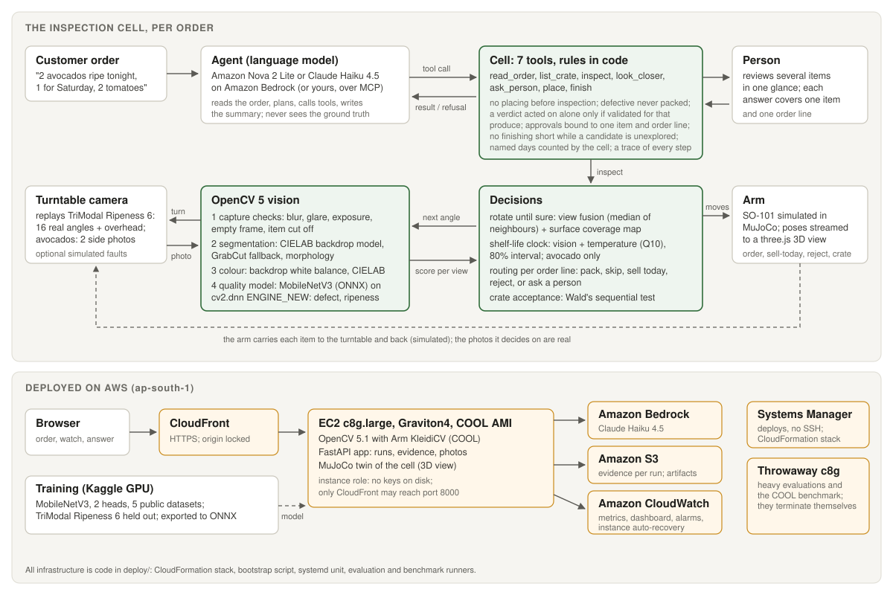

# Chhaant

**A robot cell that picks produce the way a careful shopper does, and knows when its camera can't be trusted.**
It turns each item until it is sure, picks for the day the food will actually be eaten, and asks a person exactly
where the camera cannot judge, with the evidence and a measured reason.

*Chhaant* (छाँट) is Hindi for picking out the best from a pile. An entry to the OpenCV AI Competition 2026
(OpenCV 5 + AWS).

* **Live:** <https://d1lk9oj2so3zh7.cloudfront.net> (Graviton4 with the Cloud-Optimized OpenCV Library, behind CloudFront)
* **Bring your own agent:** `claude mcp add --transport http chhaant https://d1lk9oj2so3zh7.cloudfront.net/mcp`
* **Technical report:** [docs/REPORT.md](docs/REPORT.md) · **Architecture:** [ARCHITECTURE.md](ARCHITECTURE.md)



## What it does

A customer writes an order in plain words ("2 tomatoes for a salad and an avocado for Saturday"). A language-model
agent reads it into order lines and works through a crate of real produce:

* **Inspect.** The arm puts each item on a turntable and the camera looks. OpenCV 5 finds the item, checks the photo
  is usable, reads its colour in CIELAB and runs a quality model on the new DNN engine. The cell turns the item only
  until it is sure, and says which part of the surface it never saw.
* **Decide.** Each item is routed per order line: pack, skip, sell today, reject, or ask a person. An avocado is
  packed only if its whole shelf-life forecast says it will be ripe and still good on the day it will be eaten.
* **Ask.** Where held-out validation shows the camera cannot be trusted (it missed every spoiled tomato), the cell
  puts the decision to a person, in one review per order line, with the photos and the reason.
* **Enforce.** The rules are code, not prompt. The agent cannot pack what a person declined, discard a sound item,
  or call a short order complete.

The arm is simulated in MuJoCo; every decision is made on real photographs from public datasets.

## Results at a glance

From [docs/REPORT.md](docs/REPORT.md); every number is a file in `eval/results/`.

| What | Result |
|---|---|
| Wrong items packed for a customer, 32 orders | 22 at the start, **0** after five measured iterations |
| Share of what the crate could fill, packed correctly | 81% at the start, **96%** now |
| The same 32 orders driven over MCP by an agent I did not write (Claude Code) | **0 wrong** in 65 packed, fill 94% |
| Times a person is interrupted per order | 1.7 |
| With a person who answers wrong 10–20% of the time | 11–14% of packs wrong: the zero rests on the person |
| Rotate until sure vs all 16 angles, 312 held-out sessions | **38 wrong calls vs 69**, with 3.95 views instead of 16 |
| Avocado shelf life from two photos and the temperature, 426 held-out fruit | mean error **1.05 days** |
| COOL vs the PyPI wheel on the same Graviton4; Graviton4 vs x86 | same speed and readings; Graviton4 30–41% cheaper per item |

## Repository layout

| Path | What it holds |
|---|---|
| `chhaant/vision/` | OpenCV 5 on one photo: segmentation, capture checks, CIELAB colour, the quality model, surface coverage |
| `chhaant/decide/` | Rotate until sure, shelf-life forecast, routing per order line, crate acceptance |
| `chhaant/agent/` | The cell's tools and rules, approvals, the agent loop, model backends, the trace |
| `chhaant/robot/`, `chhaant/sim/` | Turntable and camera replaying real photos; the SO-101 arm in MuJoCo |
| `chhaant/web/` | The web app, run manager, S3 and CloudWatch reporter |
| `chhaant/mcp_server.py` | The cell as an MCP server (stdio, or HTTP at `/mcp` on the site) |
| `eval/`, `eval/results/` | Evaluation scripts and their results |
| `deploy/` | CloudFormation stack, bootstrap, deploy and cloud evaluation scripts |
| `kaggle/` | Kaggle kernels: TR-6 preparation and model training |
| `scripts/` | Fetching data, the model and the arm; small command-line tools |
| `tests/` | The test suite (`pytest`) |
| `docs/` | The technical report, diagrams and a recorded trace |

[ARCHITECTURE.md](ARCHITECTURE.md) explains how these fit together.

## Setup

Python 3.12 and the pinned requirements (OpenCV 5.0.0.93, NumPy, MuJoCo, FastAPI, the MCP SDK and the AWS SDK):

```bash
python -m venv .venv
source .venv/bin/activate          # Windows: .venv\Scripts\activate
pip install -r requirements.txt
python scripts/fetch_model.py      # the quality model from the model-v1 release, SHA-256 checked
python scripts/fetch_so101.py      # the SO-101 arm model from MuJoCo Menagerie (~19 MB)
```

The data the cell inspects (not redistributed here; the scripts fetch it from the source):

```bash
python scripts/fetch_avocado.py --out data/avocado                       # avocado photos, ~0.5 GB, checksummed
CHHAANT_PREP_OUT=data/tr6 CHHAANT_PREP_ZIP=0 python kaggle/prep/prep.py  # TR-6 photos at 512 px, ~0.1 GB
```

`prep.py` reads only the photos it needs out of TR-6's 20 GB archive with HTTP range requests. On AWS Graviton the
same code runs on the COOL build that ships with the COOL AMI instead of the PyPI wheel (`deploy/bootstrap.sh`).

## Testing

```bash
pytest                              # the whole suite
pytest tests/test_cell.py           # the cell's rules
pytest tests/test_mcp_server.py     # the MCP server, including a real HTTP round trip on both protocol versions
```

No test calls a paid model or AWS: the agent tests drive the cell with a scripted model backend, and the S3 and
CloudWatch reporter is tested against stubs. The real runs are the evaluations below.

What the tests cover:

* **Vision:** segmentation, capture checks, colour, crops, coverage, and the quality model's outputs on both OpenCV DNN
  engines against the PyTorch outputs recorded at export.
* **Decisions:** view fusion, rotate until sure, the shelf-life forecast and its interval, routing, crate acceptance.
* **The cell:** every rule, approvals bound to one item and line, batch review, finish guards, camera faults, the
  agent loop.
* **The front doors:** the web API, the S3 and CloudWatch reporter, and the MCP server (forms, declined and missing
  forms, hosted jobs and their limits).
* **Simulation:** the MuJoCo arm and the twin that turns the cell's moves into motion.

Some tests need files that are fetched, and skip with the reason when they are missing:

| Needs | Tests | How to get it |
|---|---|---|
| `models/chhaant_quality_v1.onnx`, `models/reference.npz` | OpenCV vs PyTorch parity (3) | `python scripts/fetch_model.py` |
| MuJoCo and `assets/so101/` | arm and twin (17) | `python scripts/fetch_so101.py` (MuJoCo is blocked on some Windows setups) |
| `data/tr6/` | 42 more vision cases on real photos | the TR-6 step above |

Checked on 21 October 2026 from a fresh export on Ubuntu 24.04 (WSL) with Python 3.12 and only the pinned
requirements: 227 tests pass after `fetch_so101.py` and `fetch_model.py`; the 1 still skipped needs the TR-6 photos.

## Run the web app

```bash
python -m chhaant.web              # then open http://127.0.0.1:8000
```

The agent runs on Amazon Bedrock (AWS credentials with access to Claude Haiku 4.5; `CHHAANT_BEDROCK_MODEL` picks
another Bedrock model with tool use). Choose "You, here on this page" to answer the cell's questions yourself; the agent waits for your answer. Other
settings (data folders, rate limits, the S3 bucket, the time zone) are listed in `chhaant/web/__main__.py`.

## Bring your own agent (MCP)

The cell is also an MCP server, so an agent in any MCP client can work the crate under the same rules. The live site
hosts it:

```bash
claude mcp add --transport http chhaant https://d1lk9oj2so3zh7.cloudfront.net/mcp
```

There, `new_crate` opens a job of your own and returns a job id that goes with every other call. Pass
`answers: "simulated"` to have the datasets' labels answer the cell's questions when nobody is there to answer them.
Jobs close after 30 idle minutes. Or run it locally over stdio from a checkout:

```bash
claude mcp add chhaant -e PYTHONPATH=$PWD -- $PWD/.venv/bin/python -m chhaant.mcp_server
```

The tools are the cell's own (`read_order`, `list_crate`, `inspect`, `look_closer`, `ask_person`, `place`,
`finish`, plus `new_crate`), so a client's agent is refused exactly what the built-in agent is refused. `ask_person`
reaches the client's person as an MCP elicitation form, one per review with a box per item. An empty box is a no. If
the client cannot show forms, the question stays pending, and pending never counts as approval. The score against the
hidden labels is written to the server's disk and never returned to the agent.

## Reproducing the evaluation

```bash
python eval/cell_runs.py --out eval/results/cell_runs_bedrock                     # 32 orders end to end on Bedrock
python eval/cell_runs.py --reviewer-error 0.1 --out eval/results/cell_runs_bedrock_reviewer10   # a person wrong 10% of the time
python eval/mcp_runs.py                                                           # the same orders, Claude Code over MCP
python eval/score_views.py && python eval/rotate_until_sure.py                    # rotate until sure vs all 16 angles
python eval/forecast_avocado.py --data data/avocado --model models/chhaant_quality_v1.onnx
```

Every script documents its inputs at the top, and [ARCHITECTURE.md](ARCHITECTURE.md#evaluation-eval) maps each one to
its result file and report section. Heavy runs can go to a throwaway Graviton instance with `deploy/eval_job.sh`.

## Deploying to AWS

```bash
bash deploy/deploy.sh              # first time: the S3 bucket, the artifacts and the CloudFormation stack
bash deploy/deploy.sh update       # later: ship the committed tree and restart, through Systems Manager
```

It needs the AWS CLI signed in, a subscription to the COOL AMI on AWS Marketplace, and Bedrock access to Claude
Haiku 4.5 in ap-south-1. The stack is one c8g.large with an Elastic IP, CloudFront, an S3 bucket for evidence, and a
CloudWatch dashboard with alarms, for about $2 a day. [ARCHITECTURE.md](ARCHITECTURE.md#deployment-deploy) has the
details.

## Responsible use

The cell judges visible quality and ripeness only; it does not detect pathogens, residues or internal rot, and it
does not replace food-safety checks. It is built to take routine calls off a fast-moving picker and leave the hard
ones with them, with evidence, not to remove the human check. See §10 of the report.

## Licence

Apache License 2.0 (see [LICENSE](LICENSE)).

## Data and model credits

Nothing below is redistributed in this repository; scripts fetch it from the source.

| What | Source | Licence |
|---|---|---|
| TriModal Ripeness 6 (16-angle daily photos to spoilage) | figshare, doi:10.6084/m9.figshare.30783827 | CC BY 4.0 |
| 'Hass' avocado ripening photographic dataset | Mendeley Data 3xd9n945v8 | CC BY 4.0 |
| Tomato maturity and quality grading | Kaggle `sujaykapadnis/tomato-maturity-detection-and-quality-grading` (Sher-e-Bangla Agricultural University) | CC BY 4.0 |
| Banana ripeness (CEAGESP stages) | Kaggle `lucianon/banana-ripeness-dataset` | CC BY 4.0 |
| African plums quality and defects | Kaggle `arnaudfadja/african-plums-quality-and-defect-assessment-data` | CC BY-SA 4.0 |
| Fruit defects on a conveyor belt | Kaggle `josembm/industrial-fruit-defect-detection-conveyor-belt` | CC0 1.0 |
| SO-101 arm model | MuJoCo Menagerie `robotstudio_so101` | Apache 2.0 |

The quality model (`model-v1` release) was trained by `kaggle/train/train.py` on the Kaggle datasets above.
